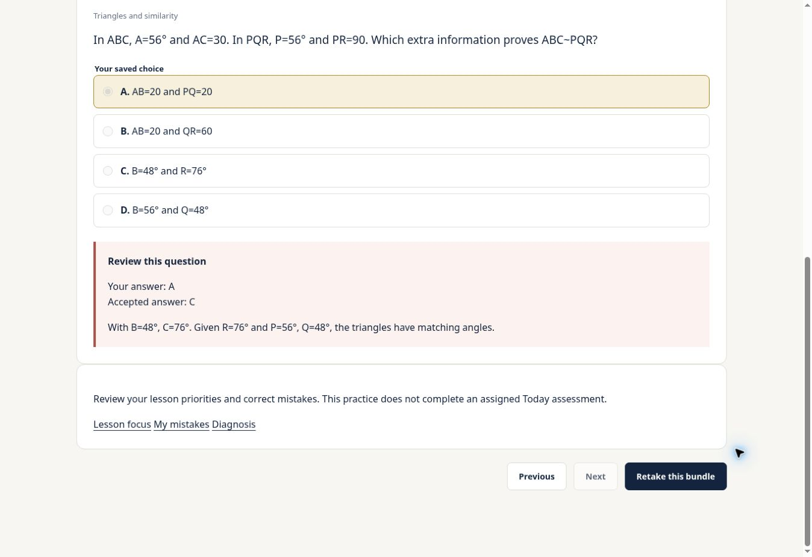

# All-course topic practice integration — November 14 release

The user authorized publication after checking remaining work. This release applies the reviewed hierarchy and integration from GitHub PR #56 to Site v191, commit `472a1e6b793b0a959d678f5f0579d40f4af8a29b`. The seven frontend files match the PR's tested commit `ce21f0f140ff3ee3078727454d493514856eb5e3` exactly. Newer hosted Today/calendar and checkpoint behavior remains present.

## Release checks

- Six PR #56 checks and all five bank-audit PR #57 checks succeeded.
- Refreshed hosted-source Node suite: 615 passed, zero failures, three existing skips.
- Refreshed isolated database suites: hierarchy 162, connected practice 185, existing bundles 71, existing diagnosis 102; all passed.
- Production build and session gate passed. Packaged asset check: 4,988 assets, 56 classic scripts, three inline scripts, 188 local links, zero broken links. Private release/SQL/test paths are not served.
- A rollback-only real-bank rehearsal applied both upgrades atomically, checked ten protected history tables and private permissions, then exercised catalogue, creation, partial save/resume, cross-session exclusion, exact unseen-count reductions, submission, notebook import, student/instructor diagnosis equality and shortage rejection. It used only an existing active test student across their five enrolled courses. All assertions passed and rollback was verified: the original catalogue hash, two original bundles, and absence of the upgrade table/function were restored. SAT English has no enrolled live test account; its behavior is covered by the six-course isolated tests.
- Live browser sign-in, home, course navigation, weekly Alex objective, Today summary and existing practice catalogue loaded. The new UI's lesson deep-link, shortage message/disabled creation and 390px mobile controls were checked with synthetic fixtures before publication.
- Supabase has no shared staging branch; local PostgreSQL-compatible tests and the explicit production rollback rehearsal supplied the database preflight. This is not a claim of real-device or cross-browser testing.

## Database application

`apply.sql` composes the two reviewed upgrades into one repeatable-read transaction with five-second lock and 60-second statement timeouts. Original function hashes reject concurrent drift or replay. Before/after row hashes protect attempts, answers, results, exams, assignments, revision sessions, bundles, snapshots, daily progress and Today notebook activity. The intended notebook import is the only existing student-data write; it preserves newer corrections and does not increment practice tries.

`rehearse.sql` additionally creates temporary test practice, then rolls the whole transaction back. It is a verification script, not a second deployment. `scripts/prepare-bundle-release-20261114.py` reproduces both files. No Edge Function or rollout/enrollment change is required.

## Question-bank recheck

The previous verified release is already live: 10,816 eligible/available questions across six courses; zero eligible but unreleased questions. The 157 unresolved holds remain 144 ACT II and 13 EST I. No source-review records were updated after the prior bank review. Missing/ambiguous source material, duplicates and instructor exclusions were not released. These totals describe availability and reviewed repairs, not a fresh mathematical certification of every historical question.

## Reliability and rollback

A recent Auth `/user` timeout was observed; the live browser subsequently restored the test session and loaded the portal. The read-only student dashboard measured approximately 5.79 seconds once, so latency remains variable. Two PostgreSQL timeouts were monitoring-exporter queries, not practice endpoints; scalar-query errors came from administrative bank inspection. Existing notification collector optimization remained installed. Optional Deno WebSocket package messages remain in function logs. No ongoing outage or new integration failure was established by the successful live checks; do not claim those background messages were fixed here.

If post-publication checks fail, restore Site v191 frontend and the captured pre-upgrade bundle/diagnosis function definitions. Restore diagnosis helpers before removing the completed-bundle notebook trigger. Retain bundle snapshots, imported notebook items and later corrections; never erase practice or recompute exam scores. The small private metadata cache can remain in place.

## Publication receipt

Both upgrades committed successfully as `all_course_practice_hierarchy_and_diagnosis_20261114`. Post-apply verification found 12,227 private subtopic rows for 12,227 questions, the notebook trigger installed, private permissions retained and the original two bundles unchanged. Site version **192**, source `f6520c4e7c0b8f80e4777c60a1c77982ce1cf999`, deployed successfully at 02:05 UTC on November 14, 2026. Supabase health checks returned no notices.

## Live post-publication test

The existing test student built a two-question medium SAT bundle under Geometry and Trigonometry → Triangles and similarity → Similar triangles. They saved one answer, left, resumed the saved answer and submitted one correct and one deliberately wrong answer. The result was 1/2 with the correct worked explanation. The wrong answer entered the existing notebook. Exactly three eligible unseen questions before the test became one afterward; both answered IDs were excluded. The test account's 55 existing exam attempts, aggregate score 54 and full history hash `c395f84b63c0cdbdf8b5dec4ae002c99` were identical before and after. Original bundle scores remained 1/2 and 2/2.

This is test-account evidence, excluded from ordinary class analytics. No ordinary student was impersonated or answered for. The live test bundle is `9b62677a-d0fa-47c3-b0bc-b141738866bc`.

