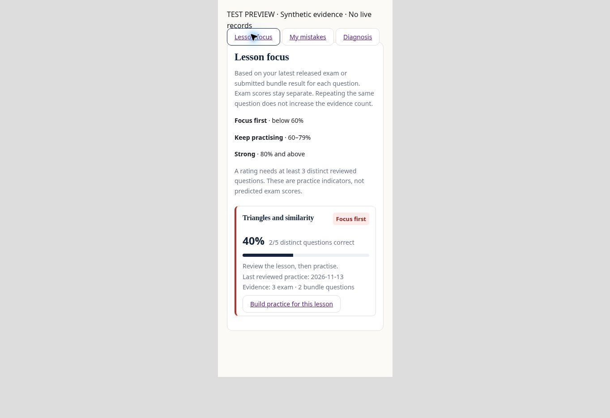

> Released on November 14 as Site **v192** after the user authorized publication if ready. [Final release checks, migration and live test](../content-releases/20261114_bundle_integration/REVIEW.md). The proposal below is retained as the historical review record.

# Topic bundles for all groups — proposal awaiting approval

No production deployment, SQL migration, rollout change, new student attempt, answer submission, score change or enrollment edit was performed for this proposal. This document retains its original filename so existing review links continue working.

## Scope and existing architecture

The current draft extends Practice Bundles to every enrolled student in all six supported courses. Group membership is not a feature gate: students in different groups or multiple groups use the same course workspace, while their answer history and progress remain personal. Existing enrollment, active-account, device and authentication checks stay authoritative.

| Course | Main topic organization |
|---|---|
| SAT Math | Algebra; Advanced Math; Problem-Solving and Data Analysis; Geometry and Trigonometry |
| EST I Math and EST II Math | Existing Algebra, Advanced algebra, Geometry, Trigonometry, Statistics/probability/data and additional bank-topic sections |
| ACT 2 Math | Existing mathematics sections, including Additional mathematics for matrices, vectors and related lessons |
| EST English and SAT English | Existing reading, conventions, expression of ideas, craft/structure and English-skills sections |

Every course supports whole lessons and nested subtopics, difficulty, 1–100 questions, exact eligible counts, and exclusion of previously answered questions. Only sections represented in the course's eligible bank are listed, except SAT's four fixed domain choices. Missing subtopic tags show **General lesson practice**. Tags are taken from `assets.lesson_subtopic`; no question content is guessed or relabeled.

The initial source inspection found Site v189 at `a68ba44524226da1a6b24e4586c3e09757c8392a`, ahead of GitHub main `1237eb14a9bfe2268beacd8f9bd789707cf08c72`. Practice Bundles was already hosted and its database rollout enabled. The PR's first commit preserves that existing service and dependencies, adapting static copies to GitHub's `dist/`. Subsequent commits are the proposed hierarchy and all-course extension. The live catalogue definition still matched the reviewed hash when rechecked for this extension; the proposal metadata table did not exist.

## Proposed changes

| Files | Result |
|---|---|
| `web/practice-bundles.html`, `.js`, `.css`, `bundle-core.js` and static copies | Nested lesson/subtopic controls; counts follow difficulty and repeat exclusion; refresh preserves selections, even at zero availability. Failed catalogue loads disable creation. |
| `web/final-revision.js` and static copy | A course-specific **Custom topic practice** shortcut for SAT, EST I and EST II, the courses supported by Final Revision. The existing hosted global Practice Bundles navigation already serves all six courses. |
| `supabase/sql/practice_bundle_hierarchy.sql` | Guarded upgrade of four existing functions and a private, trigger-maintained subtopic cache for all six courses. It supersedes the unapplied SAT-only proposal; do not apply both. |
| `web/portal-controls.js`, `hardest-questions.js` and static copies | Lesson Focus and My Mistakes open the selected lesson in the builder; Diagnosis keeps Final Revision actions and adds custom practice. SAT English receives appropriate labels. Implausible elapsed-time records are labelled for review, not presented as measured pacing. |
| `supabase/sql/practice_bundle_integration.sql` | Guarded, atomic integration of completed bundle evidence into student/instructor lesson diagnosis and wrong answers into the existing notebook. |
| Tests and `.github/workflows/sat-topic-bundles.yml` | All-course filtering, history, eligibility, isolation, saves, grades, rendering and enrollment regressions. The workflow runs tests only, with no production credentials or deployment step. |

Whole lessons and chosen subtopics form a union; domain and difficulty intersect that selection. Choosing a whole lesson clears its individual subtopic checkboxes. Choosing a subtopic clears its whole-lesson checkbox. No checkboxes means all lessons in the selected main topic.

If fewer questions remain than requested, creation is disabled and **Use N available questions** offers an explicit count change. The server rechecks eligibility and history at creation and rejects a shortage without inserting a smaller bundle or repeating answers. SAT supplementary/unclassified topics remain outside the four-domain pool; other courses retain their existing topic coverage.

## Repeat prevention and preservation

The unchanged history query checks saved nonblank responses in exam/assignment attempts, notebook tries, Daily Quiz, drills, Final Revision, and partial/completed practice bundles. It has no recent-session limit. Correct and incorrect responses both exclude that exact question ID; blanks and other students' answers do not.

Similar ideas with different IDs can still appear. Unsaved answers or erased history cannot be reconstructed. Existing grading, explanations, immutable completed results, retakes, autosave and resumption are reused. Exams, assignments, Today objectives, Daily Quiz points and historical scores are not rewritten. Access to a course still requires the existing active enrollment.

## Connected learning workflow

The current implementation was checked against hosted **v191**, source `472a1e6b793b0a959d678f5f0579d40f4af8a29b`. Its newer Today/calendar changes are preserved. Do not deploy GitHub's older full static tree over this hosted source.

- Lesson Focus, Diagnosis and My Mistakes link to the course and exact lesson. An unavailable lesson blocks creation instead of silently opening broad mixed practice.
- A submitted bundle contributes its latest result for each distinct question to the shared student/instructor lesson evidence query. Autosaves do not contribute. Exam and bundle evidence counts are shown in Lesson Focus. The original exam history, raw/scaled scores and summary score calculations remain untouched.
- A wrong answer on first submission enters the existing notebook. A new mistake may reopen an old mastered item; duplicate submit requests cannot reset later corrections. Historical import preserves more recent notebook mastery.
- Importing errors does not increase notebook tries or produce Today completion evidence. Only the existing notebook answer operation does that. Two correct notebook responses still master an item.
- Retakes replace evidence for the same question without inflating distinct-question counts. Held, reserved, deleted or changed bank versions do not contribute stale bundle evidence; historical bundle scores remain frozen.
- No new assessment engine, duplicate assignment, group-specific enablement or student-specific workflow is introduced. Instructor Diagnosis consumes the same shared lesson helper; selected-exam diagnosis remains restricted to that exam.

## Validation

| Area | Verified result |
|---|---|
| Complete current hosted-source Node suite | **615 passed, 0 failed, 3 existing skips** (618 tests); includes authentication/device controls, navigation, exams/assignments, Final Revision, Diagnosis, Today, December planner, checkpoints, group/student administration, notifications and mathematical rendering |
| Focused bundle/integration Node suite | **97 passed, no skips** |
| Existing bundle database behavior with hierarchy upgrade | **71 assertions passed** |
| Hierarchy, eligibility and repeat prevention | **162 assertions passed** across six courses, six history sources and separate/multiple groups |
| Connected practice database | **185 assertions passed**, including actual notebook state/answer RPCs, two-answer mastery, import/retry safety, student/staff evidence equality, locked exams, stale/held/reserved content, score preservation, private function permissions and upgrade replay rejection |
| Existing Diagnosis database suite | **102 checks passed** |
| Today / study planning / weekly objective database suites | **39 + 17 + 10 assertions passed** |
| Browser preview | Desktop: lesson → selected bundle → MCQ/numeric answers → submission → My Mistakes/Diagnosis. 390px embedded viewport: Lesson Focus, Diagnosis and bundle controls; no page overflow (375px usable width including scrollbar). Real math, table and diagram renderers used with synthetic data. |
| Live test-account smoke check | Home, enrolled course navigation, weekly Alex assessment card, Today summary, lesson catalogue, existing bundle catalogue, Diagnosis, My Mistakes and Lesson Focus loaded. No exam or bundle was started/submitted. |

The live test account initially displayed “Progress is temporarily unavailable”; one manual **Retry progress** recovered Diagnosis and Lesson Focus. A bounded read-only database check measured the existing dashboard at about 0.90 seconds and its lesson helper at 0.51 seconds; these are single observations, not load-test guarantees. The 18:00–23:30 UTC log window contained two notification endpoint errors and two `portal_push_collect` timeouts. Other observed SQL errors/timeouts largely came from administrative inspection queries. Notification delivery and intermittent progress latency remain release-review items; no production fix is claimed here.

Current released questions had no mismatch between `topic` and nonblank `curriculum_lesson`, supporting exact lesson links. Automated tests use synthetic records; the **new SQL upgrade has not been applied to a shared staging or production database**. Real-device/cross-browser testing of the combined upgrade and production-scale performance remain final release gates. Existing skipped tests and browser-install restrictions are not counted as passes. See the PR's Checks for current CI results.

## Deploy only after approval

1. Refresh the current hosted source and database hashes; reconcile concurrent work before changing production.
2. Apply `supabase/sql/practice_bundle_hierarchy.sql`, followed by `supabase/sql/practice_bundle_integration.sql`, first in staging. It checks the four reviewed function hashes and rejects drift/replay. Do not replay `practice_bundles.sql` or `question_eligibility_cache.sql`, which document the already-live baseline.
3. After successful staging checks and explicit approval, apply the two reviewed upgrades and deploy the seven changed frontend files and their static copies onto refreshed hosted source. No existing Edge Function redeployment, rollout toggle, enrollment edit or group-by-group setup is required.
4. Resolve or explicitly review the observed progress/notification reliability issues before signing off production. Check an enrolled test account's catalogue and selection in each relevant course, saved-answer exclusion, explanations and navigation; confirm ordinary exams, assignments and Today still behave as expected.

Rollback restores the previous four bundle function definitions from `practice_bundles.sql`, the two diagnosis helpers captured in `tests/fixtures/bundle-integration-before.json`, and the previous frontend files. Remove `completed_bundle_notebook` and its helper only after restoring the diagnosis helpers; retain imported notebook mistakes and any subsequent corrections. Retain practice records and the small metadata cache/trigger; never delete or recompute historical student results.

## Reproduce

```bash
npm ci --prefix tests/device-runtime --ignore-scripts --no-audit --no-fund
npm ci --prefix tests/passage-runtime --ignore-scripts --no-audit --no-fund
npm ci --prefix tests/english-runtime --ignore-scripts --no-audit --no-fund
node --test tests/practice_bundles.test.cjs tests/practice_bundles_dom.test.cjs tests/practice_bundle_auth.test.cjs tests/practice_connections.test.cjs tests/finals_diagnosis.test.cjs tests/diagnosis_coherence_ui.test.cjs tests/final_revision.test.cjs tests/portal_math.test.cjs tests/practice_figures.test.cjs
node tests/practice_bundles_db.cjs
BUNDLE_HIERARCHY=1 node tests/practice_bundles_db.cjs
node tests/practice_bundle_hierarchy_db.cjs
node tests/practice_bundle_integration_db.cjs
```

## Mobile preview


