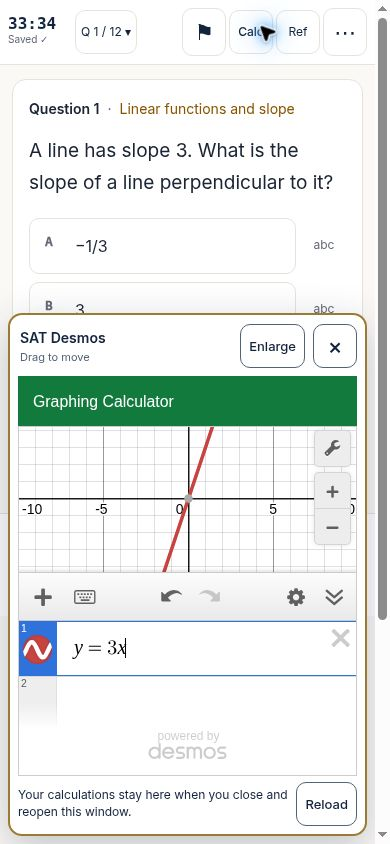

# Desmos popup — 15 November 2026

Desmos opens in a floating, nonmodal window on the current SAT question page. The separate-tab link is removed. Desktop users can drag, resize and enlarge it; phone users get a compact popup with the question still visible above it and an optional enlarge control. Closing and reopening or moving between questions preserves the same calculator frame. A new attempt clears it. Reload is explicit and stays in the popup.

The official College Board Desmos site remains isolated in an iframe with no exam/user identifiers or referrer. The frame cannot open popups or navigate the parent. Exam answers, deadlines, submit behavior and SAT eligibility are unchanged. No database changes.

Verification: 15 focused regression tests and 33 browser interaction/layout checks passed. Live Desmos in the synthetic browser fixture accepted y=x^2, retained it across close/reopen and a question change, and rendered y=3x in the 390px phone popup. Desktop enlarge/reduce and keyboard movement stayed within the viewport. Production build passed with 4,996 assets and zero broken local links. Browser widths are simulated; a physical-phone keyboard has not been tested.

