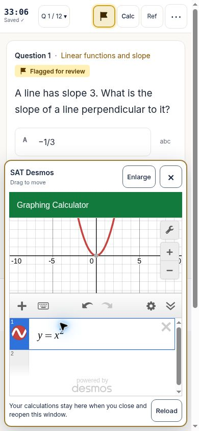

# Flag and study-planner repair — 15 November 2026

The flag used overlapping pseudo-element shapes and two render paths that replaced its text with a font glyph. The runner, question notice, question navigator and review now share an inline SVG. Toggle/answer/navigation operations retain the toolbar SVG node, filled state, accessible label and saved flag state.

The planner's global `history` boolean could shadow the browser History object in a host wrapper. Renaming it to `progressView` fixes the reproduced receiver error. URL synchronization also preserves the host's existing History state, avoids redundant updates and catches failures so optional URL persistence cannot prevent the plan from rendering. The workspace extension uses the renamed view state. Script query versions were bumped for the affected pages.

Verification:

- All 640 CommonJS regression assertions passed; three pre-existing baseline tests intentionally skipped. Focused flag, planner, unified-navigation and calculator coverage passed (77 tests).
- Browser rehearsal passed 34 interaction/layout checks at 360, 390, 900 and 1280 pixels, using real production markup and scripts with synthetic assessments and blocked portal API requests.
- The planner fixture installs a History wrapper reproducing the name collision. Today, Progress and Calendar rendered and updated their URLs successfully; the phone layout had no horizontal overflow. A separate automated regression confirms that a throwing History implementation cannot blank objectives or cause database writes.
- The real official Desmos frame loaded and graphed `y=x^2` in the phone popup. Flags and the question remained visible. Calculator frame persistence and exam state isolation passed automated/browser checks.

No database changes are required for this repair. No production attempt was submitted. Physical-device keyboard behavior remains unverified. Existing browser approval restrictions prevented a signed-in production walkthrough; verification uses isolated fixtures plus deployment/asset checks.

