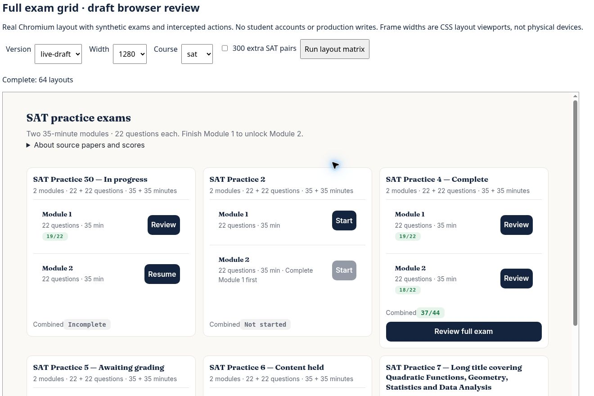
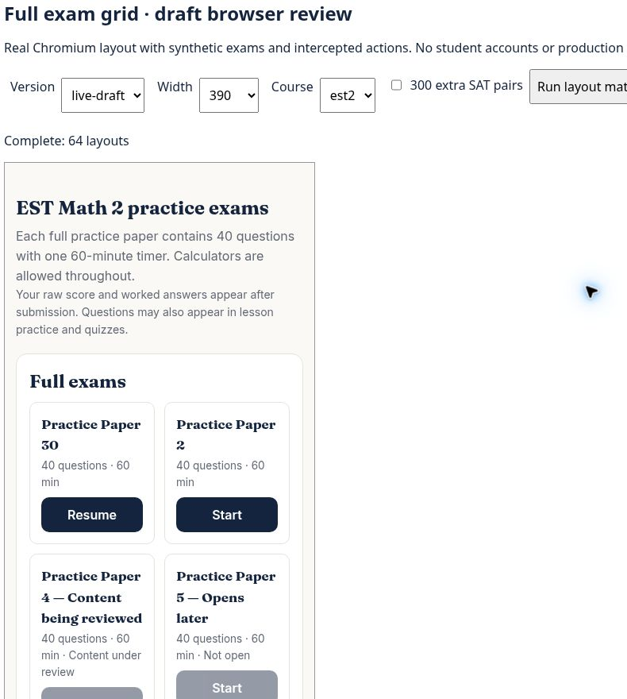

# Full-exam grid validation — November 21, 2026

**Decision: keep PR #68 in draft; hold merge and production deployment.** The focused corrections pass the tests below. A wholesale deployment of this branch would replace a newer live frontend. A signed-in production smoke test and integration with the current Sites source are still required before proposing either release action for explicit approval.

## What is live

The portal already contains the grid. Sites version **205**, source `8755fae18144f054cedcc7ad4561517752f03213`, has a successful November 20 deployment. Its public index and all 13 linked local stylesheets were retrieved. A second fetch at the end of the review returned the same HTML hash; the Sites version remained 205.

The reviewed PR head was `40a22a67be2402a9636a28184821057813b09047`, open, draft and mergeable, based on `4f1f8384b433964dcb0c25f96ac3159324c5e6a3`. Its eight existing GitHub check runs were successful, including general browser workflows. Those workflows are separate evidence from this focused grid review.

| Area | Original PR #68 | Live version 205 | Proposed correction |
| --- | --- | --- | --- |
| SAT grid at 1280px | Four columns, roughly 278px cards | Three columns, roughly 376px cards | Align the PR with the live 310px minimum |
| SAT card spacing | Older heading/note margins | More compact heading/note margins | Retain the live refinements |
| Short single-paper card at 360px | 283 × 335px | 283 × 335px | 283 × 283px after removing the inherited mobile flex basis |
| Unpaired SAT module in progress | Appended after other singles | Same ordering defect | Re-sort singles after grouping |
| Accessible action names | Repeated “Start”, “Review”, “Resume” | Same ambiguity | Include the exam title and module in each name |
| Both modules submitted, grading pending | Combined score shown as a dash | Combined status incorrectly says “Incomplete” | Show “Awaiting grading”; keep review actions and score data |
| Access and runner behavior | Older implementation | Newer course access/can-finish checks, module handling, error handling and runner changes | Preserve the live implementation; do not overwrite it with the PR files |

The live version also contains English pathways, the November practice entry, shared UI styles, and other changes absent from the PR. This task does not synchronize those unrelated features.

## Browser evidence

Real Chromium rendered the **exact extracted renderer, dashboard event wiring and stylesheet cascade** from each source, with the actual Google fonts loaded. The test used synthetic exams and intercepted start/review actions. The layout viewports were iframe widths of 360, 390, 768 and 1280 CSS pixels; they are not physical-device or mobile-OS emulation. Native scrollbar space can affect the available content width.

The final matrix contains **64 layouts**: original PR, corrected PR, live snapshot, and narrowly patched live snapshot × SAT, EST I, EST II and ACT II × four widths. Across all 64, measurements found no horizontal document overflow, card-content bounds violations, or card buttons smaller than 44 × 44px. Long spaced/unbroken titles, held/closed papers, retakes, pending grades, completed pairs, and in-progress attempts were included. Cards expand vertically when content requires it; forcing every card into a rigid square would clip long content.

| Viewport | Corrected SAT pair columns | Single-paper columns | Result |
| --- | --- | --- | --- |
| 360px | 1 | 1 | Fits; controls and titles remain visible |
| 390px | 1 | 2 | Fits; narrow cards grow for longer text |
| 768px | 2 | 3 | Fits |
| 1280px | 3 | 5 | Fits |

Direct keyboard interaction confirmed Tab navigation, skipping disabled Module 2, visible 2px focus outline, Enter activation of Resume, and Space activation of a retake. Action records retained the intended exam ID and `untimed: false`. The names in the browser accessibility tree include the title/module. This was not a screen-reader audit.





Screenshots show controlled fixtures, not students' live exam records. `original-desktop.jpg`, `live-desktop.jpg`, and `draft-desktop.jpg` provide the comparison states.

## Regression and performance evidence

- **48 local regression tests passed**, including 11 new grid checks plus existing SAT full-review/submission, course navigation, ACT, lesson-library and question-flag tests. The new grid suite is included in the JavaScript CI job. See `final-regressions.txt`.
- **24 additional simulated access scenarios passed** comparing the live snapshot with its overlay: four courses, open/closed/finish-existing access, and normal/stale-first-module states. The start/review target IDs, enabled/disabled states and visible button labels were identical. See `overlay-checks.json`.
- The PR follow-up leaves `wireDashboard()` and everything following it byte-for-byte unchanged from the original PR. The live overlay independently preserves that entire region from version 205, including the newer runner, submission and review handling. No backend functions, timers, question data or scores were changed.
- Normal fixture rendering and forced layout, measured seven times per layout, had medians of **13.5ms original PR / 13.4ms corrected PR / 7.5ms live / 8.8ms live overlay**. There were noisy individual samples up to 151ms. These are local rendering timings, not production loading guarantees; font/network loading is outside these renderer samples.
- A deliberately oversized **311-card / 619-record** SAT catalogue took a median **612.6ms original / 592.0ms corrected**, with maxima of 777.9ms / 765.6ms. The variation does not establish a reliable speed improvement. Rendering hundreds of cards still causes a noticeable main-thread pause; measure the largest actual assigned catalogue before release. Pagination or incremental rendering would be separate work if those sizes occur in practice.
- The follow-up adds 628 uncompressed bytes to the original PR HTML; the live overlay adds 627 bytes. No new asset requests or backend requests are introduced. One public HTML fetch returned HTTP 200 in 6.34 seconds through the executor network, including proxy/network overhead. This single sample does not diagnose server latency or measure authenticated exam-list loading.

## Limits and release proposal

The actual live page opened at sign-in. No student session was available, so real authenticated listing latency, resume persistence, answer saving, submission, grading and review persistence were **not verified against production**. Simulated handler tests do not establish those outcomes. No focused Firefox, WebKit, physical phone/tablet, touch-event or assistive-technology run was performed in this session. Measuring touch-target bounds is not a touchscreen test.

Two reviewable drafts are supplied:

1. The corrections to `web/index.html` and `dist/index.html` on PR #68, with regression tests.
2. `live-v205-grid.patch`, a narrow patch against the captured live index. It keeps the newer live access/runner logic and shared styling. It has been browser-tested locally, **not applied to Sites or packaged as a deployable version**. Source-helper opening failed in this session; public deployed source was sufficient for the comparison, not a substitute for preparing the real Sites checkout.

Before release: refresh the actual Sites checkout, apply only the reviewed changes to its current source/artifact pipeline, run a signed-in test-account cycle through start/resume, Module 1 unlock, submission and full review, and check the largest real catalogue's loading time. Then present the exact merge commit and saved deployment version for the owner's separate explicit approval. **No merge or production deployment was performed.**

## Reproduction and evidence

`provenance.json` records source/deployment identifiers, HTML and stylesheet hashes, and the final live recheck. `live-v205-snapshot.zip` contains only publicly served HTML/CSS; it contains no student records or session credentials. Extract it into a temporary directory. Copy `live-index.html` to `live-draft-index.html` and apply `live-v205-grid.patch` to that copy (the patch paths are `index.html`; use an isolated temporary directory). The patch must apply to the recorded snapshot hash, not an assumed current version.

From the repository root:

```sh
npm ci --prefix tests/english-runtime --ignore-scripts --no-audit --no-fund
npm ci --prefix tests/passage-runtime --ignore-scripts --no-audit --no-fund
node --test tests/full_exam_grid.test.cjs tests/sat_full_review_ui.test.cjs tests/act2_course_ui.test.cjs tests/lesson_exam_library.test.cjs tests/navigation.test.cjs tests/all_course_navigation.test.cjs tests/exam_flags.test.cjs
node tests/check_live_grid_overlay.cjs /absolute/snapshot/live-index.html /absolute/snapshot/live-draft-index.html
node tests/build_full_exam_grid_qa.cjs /absolute/qa-preview /absolute/snapshot/live-index.html /absolute/snapshot/live-draft-index.html
```

The original PR commit must be available locally for the comparison builder. Serve the generated preview using the supported preview environment, then choose **Run layout matrix**. The harness runs entirely with synthetic records and local intercepted actions. `browser-matrix-final.json`, `keyboard.json`, `live-overlay-keyboard.json` and `stress-render-final.json` contain the recorded measurements.
